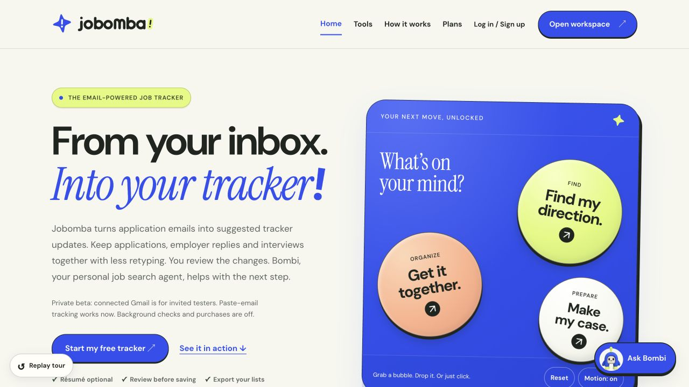
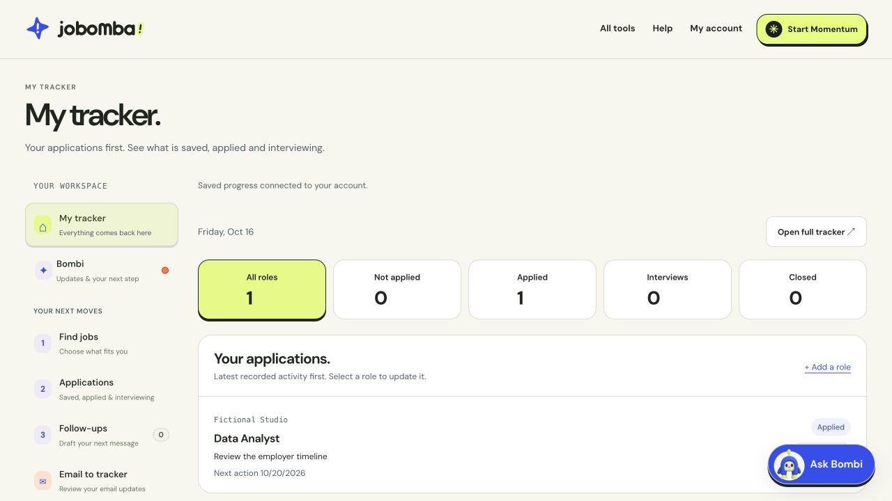
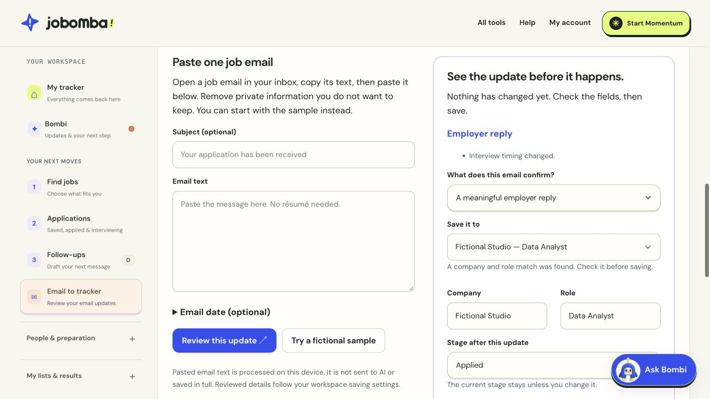

# Jobomba

A job-search workspace for keeping opportunities, contacts, interview preparation and next steps together.

This repository presents the project through screenshots and a short overview. The working application and its source remain private.

All screenshots show fictional demo sessions and specific interface snapshots captured during development.

## What it does

- Track opportunities, application stages, contacts and follow-ups.
- Prepare interview answers, use optional AI coaching and create practice cards from saved answers.
- Review résumé text locally and choose what to share with the coach.
- Review pasted application emails before applying suggested tracker changes.
- Export selected tracker data and create local workspace backups.

### Opportunity tracker

### Review before updating

## How it is built

The frontend uses HTML, CSS and JavaScript for editing, document text review and export preparation. A Cloudflare Workers backend handles account requests and AI calls, with Supabase Auth for sign-in, Cloudflare D1 for saved workspace data and the OpenAI API for optional coaching.

Development includes automated regression checks and fictional browser scenarios for editing, saving, recovery and document handling.

## My role and development approach

I set the product direction and make scope and release decisions. I use AI coding assistants to support implementation, debugging, regression testing and documentation.

## Current status

Jobomba is in private beta, with wider user validation still pending. Scheduled searches, inbox refreshes and automatic alerts are currently off.
